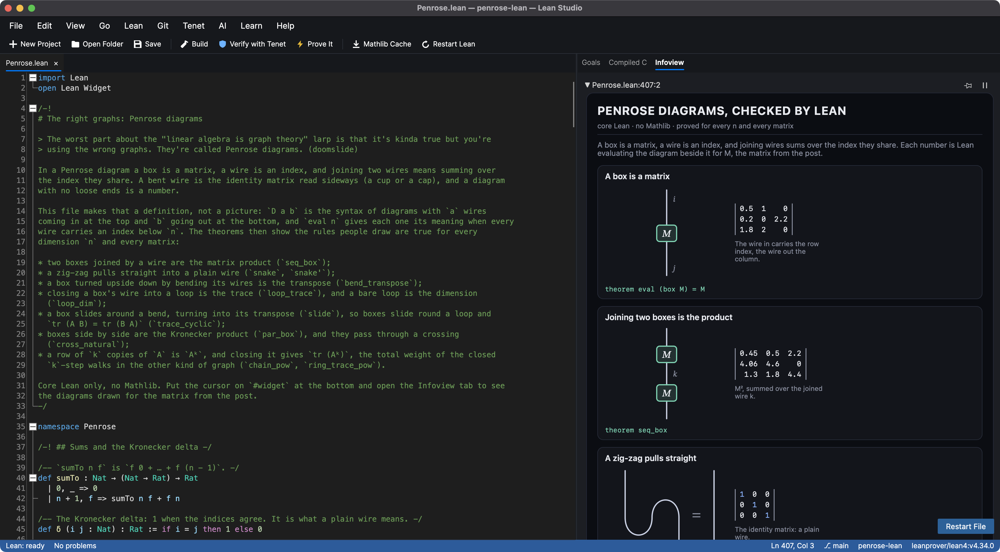
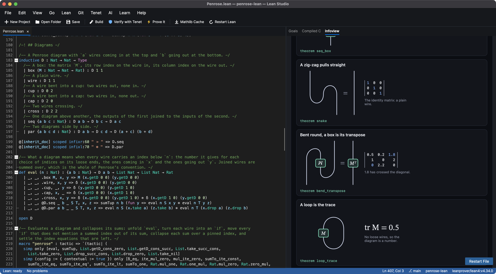
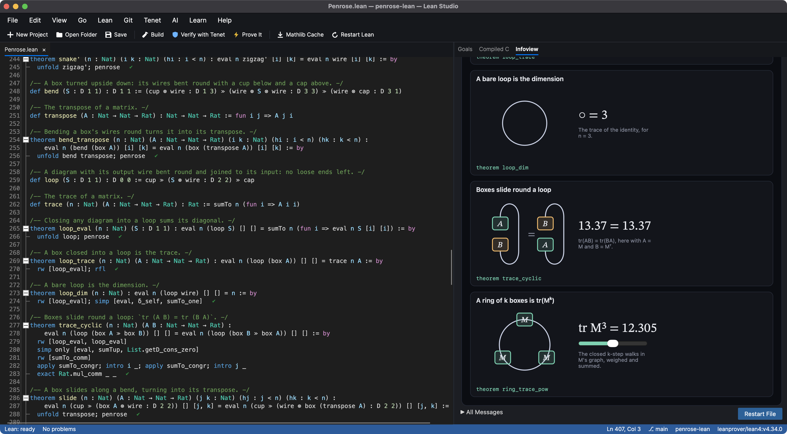
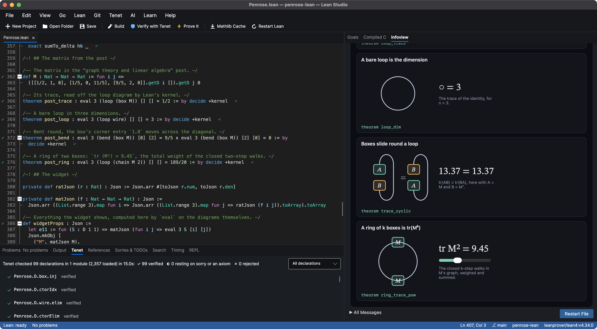

# The right graphs: Penrose diagrams in Lean

> The worst part about the "linear algebra is graph theory" larp is that it's kinda true but you're using
> the wrong graphs. They're called Penrose diagrams. (doomslide)

Fair. So here are the right graphs, as a definition rather than a picture, with the rules people draw
proved for every dimension and every matrix.



In a Penrose diagram a box is a matrix, a wire is an index, and joining two wires means summing over the
index they share. A bent wire is the identity read sideways (a cup or a cap), and a diagram with no loose
ends is a number. `D a b` is the syntax of diagrams with `a` wires in at the top and `b` out at the bottom,
built from boxes, wires, cups, caps and crossings by stacking (`≫`) and placing side by side (`⊗`).
`eval n` gives each diagram its meaning when every wire carries an index below `n`: the sum, over the
indices on its joined wires, of the product of its pieces. That is the whole of Penrose's convention.



## What is proved

Everything in `Penrose.lean`, for every dimension `n` and every matrix:

| Theorem | The rule |
| --- | --- |
| `seq_box` | Two boxes joined by a wire are the matrix product. |
| `snake`, `snake'` | A zig-zag pulls straight into a plain wire. |
| `bend_transpose` | A box turned upside down by bending its wires is its transpose. |
| `slide` | A box slides along a bend, turning into its transpose. |
| `loop_eval`, `loop_trace` | Closing a diagram into a loop sums its diagonal: a box in a loop is the trace. |
| `loop_dim` | A bare loop is the dimension. |
| `trace_cyclic` | Boxes slide round a loop, so `tr (A B) = tr (B A)`. |
| `par_box` | Boxes side by side are the Kronecker product. |
| `cross_natural`, `cross_cross` | Boxes pass through a crossing, and two crossings undo each other. |
| `chain_pow`, `ring_trace_pow` | A row of `k` boxes is `Aᵏ`; closed into a ring it is `tr (Aᵏ)`, the weight of the closed `k`-step walks in the other kind of graph. |
| `seq_assoc`, `wire_seq`, `seq_wire` | Stacking is associative and a plain wire changes nothing, so a tall diagram means the same however it is read. |



Each rule is a statement about `eval`, and most proofs are one line: `penrose`, a tactic defined in the
file that unfolds a diagram, turns every wire into an `if`, collapses each sum over an index a wire pins
down, and settles the index equations that are left. The rest use a handful of summation lemmas proved in
the same file. The last four theorems evaluate diagrams for `M`, the matrix from the post, by
`decide +kernel`: its trace is 0.5, a bare loop in three dimensions is 3, bending moves the 1.8 across the
diagonal, and a ring of two boxes gives `tr (M²) = 9.45`.



Everything rests only on Lean's three standard axioms, and Tenet, Lean Studio's independent kernel,
re-checks all 99 declarations: 99 verified, none resting on `sorry` or an axiom, none rejected.

What this is not: the general theorem that any two diagrams related by planar isotopy evaluate the same
(Joyal and Street's coherence theorem). The rules above are the moves that deformation is made of, each
proved on its own; the general statement is a bigger project.

## Try it

1. Install [Lean Studio](https://github.com/keithadler/leanstudio) (on a Mac: `brew install --cask keithadler/tap/lean-studio`).
2. Clone this repository, open the folder, and run **Build**.
3. Open `Penrose.lean`, click the last line (`#widget PenroseWidget with widgetProps`) and choose the
   **Infoview** tab.

It works the same in VS Code with the Lean 4 extension. Without Lean there is a
[browser version](https://keithadler.github.io/penrose-lean/) of the widget, fed the numbers Lean computes.

```sh
lake build
```

Core Lean 4.34, no Mathlib.

## Files

- `Penrose.lean`: the diagrams, their meaning, the proofs, the post's matrix and the widget's data
- `widget/Penrose.js`: the widget (React, nothing beyond what the infoview provides)
- `docs/`: the browser version; `scripts/build-docs.sh` refreshes it from Lean

Made with [Lean Studio](https://github.com/keithadler/leanstudio) and the assistance of Claude (Anthropic).

MIT License.
